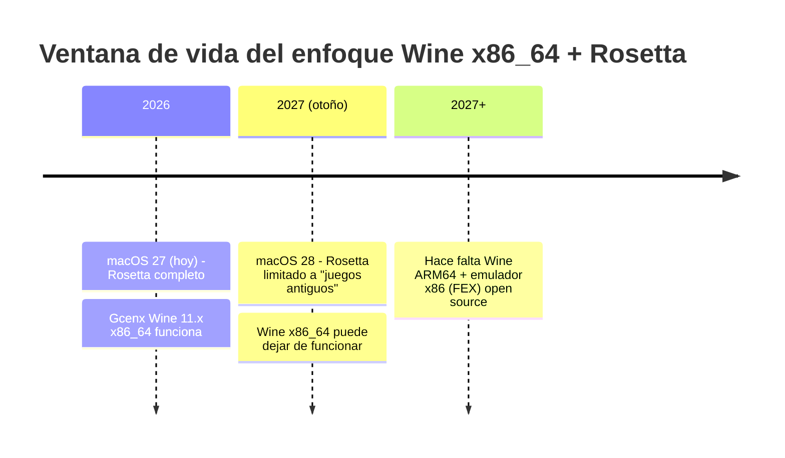
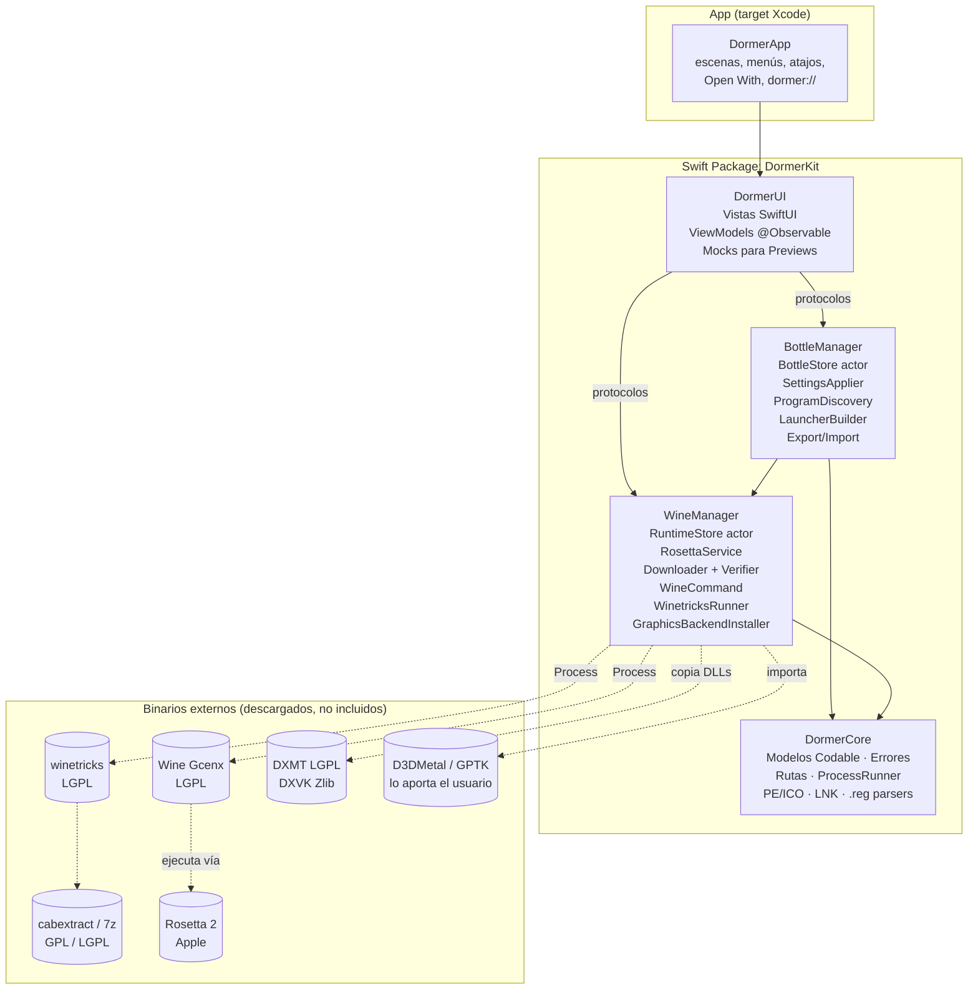
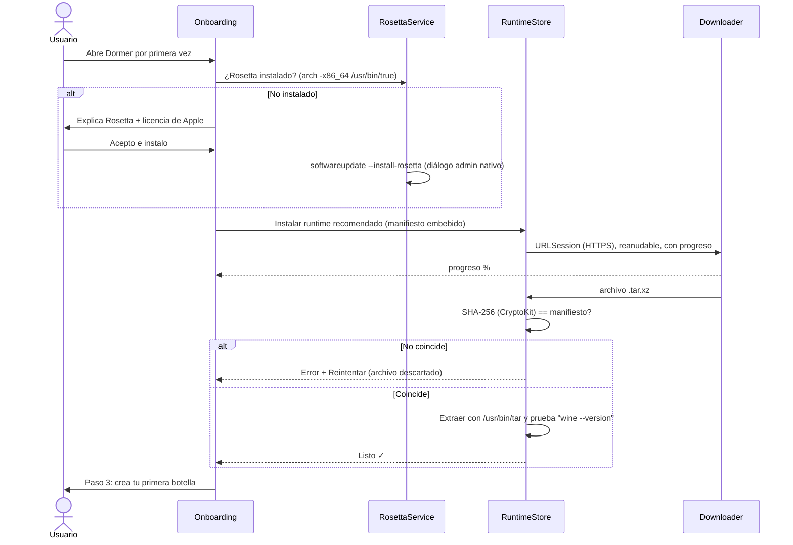
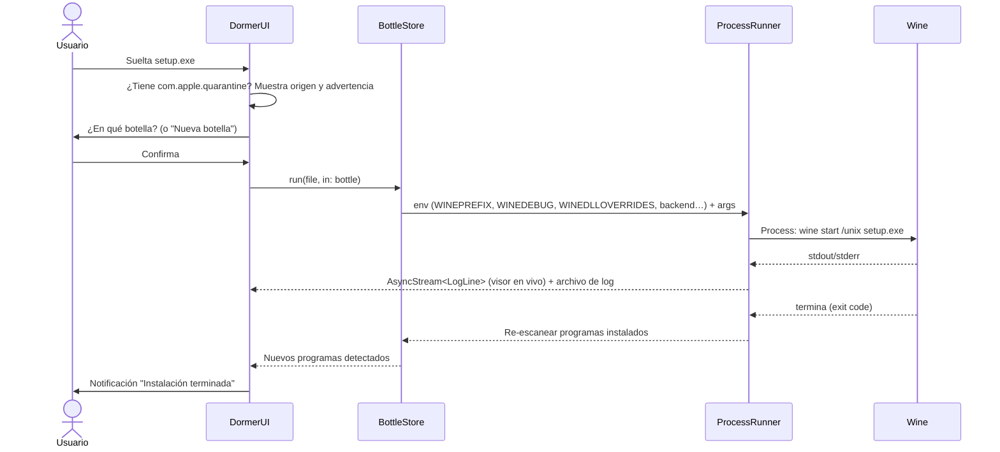

# Dormer: documento de diseño (Fase 0)

> **Estado:** ✅ aprobado · **Fecha:** 2026-11-11 · **Nombre:** *Dormer* (ver §11)
>
> Este documento no contiene código. Define arquitectura, pantallas, riesgos y plan por fases.

---

## 0. Resumen ejecutivo

**Dormer** es una app nativa de macOS (SwiftUI) gratuita y open source que instala y ejecuta programas de Windows usando **Wine** como binario externo descargado aparte. Cada programa vive en una **botella** (un prefijo de Wine aislado). El usuario no necesita abrir la terminal en ningún momento.

**Tres cosas que tienes que saber antes de aprobar:**

1. **Rosetta 2 tiene fecha de término.** Apple mantiene Rosetta completo **hasta macOS 27** (el que tienes instalado: 27.2.1). En **macOS 28 (otoño 2027)** queda solo un subconjunto para *juegos antiguos sin mantenimiento*. No se sabe si Wine cabe en ese subconjunto. Todos los builds gratuitos de Wine para Mac (Gcenx) son **x86_64** y dependen de Rosetta. Detalle y mitigación en §2.1.
2. **Algunas cosas del enunciado no son posibles tal como están escritas en macOS actual.** Por ejemplo, *clic derecho > Abrir* ya no salta Gatekeeper desde macOS 15, no existe una API pública para anclar al Dock y DXVK-macOS está prácticamente sin mantenimiento. Están listadas con alternativas en §2.2.
3. **Winetricks necesita `cabextract` (y a veces `7z`)**, que macOS no trae. Hay que compilarlos y distribuirlos aparte (son GPL/LGPL, así que se puede). Ver §2.2.

---

## 1. Hallazgos verificados (2026-11-11)

| Tema | Hallazgo | Fuente |
|---|---|---|
| Equipo de prueba | macOS **27.2.1** (26B131), Apple **M5**, Xcode 27.2, Swift 6.4.2, Rosetta instalado | `sw_vers`, `sysctl` locales |
| Rosetta 2 | Completo hasta macOS 27. En macOS 28 queda solo un subconjunto para juegos antiguos que dependen de frameworks Intel. macOS 26.4 y posteriores ya muestran avisos. | [MacRumors](https://www.macrumors.com/2025/06/10/apple-to-phase-out-rosetta-2/), [Apple Dev Forums](https://developer.apple.com/forums/thread/787530), [TechRepublic](https://www.techrepublic.com/article/news-apple-macos-26-4-rosetta-2-support-ending/) |
| Wine para Mac | Gcenx/macOS_Wine_builds **11.21** (31-oct-2026), `wine-devel` y `wine-staging`, solo **osx64**, ~225 MB. GitHub publica `sha256` por asset. Trae wine-mono 11.3.0, wine-gecko 2.47.4 y GStreamer 1.28.1. | GitHub API |
| Wine ARM64 nativo | CodeWeavers (CrossOver, de pago) ya distribuye builds ARM64 con un **FEX** adaptado a macOS (requiere macOS 26.5 o superior). Sin builds gratuitos equivalentes por ahora. FEX upstream es **MIT**. | [CodeWeavers blog](https://www.codeweavers.com/blog/mjohnson/2026/06/11/whats-in-and-whats-out-for-crossover-27), [AppleInsider](https://appleinsider.com/articles/26/06/11/crossover-a-windows-to-mac-gaming-tool-goes-apple-silicon-only) |
| DXMT | **LGPL-2.1+**, v0.80 (abr-2026), D3D10/11 a Metal, activo (commits ayer). Incluido en CrossOver 26. | GitHub `3Shain/dxmt` (LICENSE) |
| DXVK-macOS | **Zlib**, última release v1.10.3 (jul-2024), D3D9-11 a Vulkan vía MoltenVK. **Estancado.** | GitHub `Gcenx/DXVK-macOS` |
| winetricks | **LGPL-2.1**, activo. Requiere `cabextract`, `unzip` y `7z` para varios verbos. | GitHub `Winetricks/winetricks` |
| D3DMetal / GPTK | Licencia de Apple que **prohíbe redistribuir**. El usuario lo descarga desde developer.apple.com con un Apple ID gratuito. | Licencia de GPTK |
| Whisky | Archivado (GPL-3.0, mayo-2025). Solo sirve como inspiración de UX; no se copia nada. | GitHub |
| Homebrew | Homebrew 5 deprecó `--no-quarantine` y deshabilitó los casks sin firma del tap oficial (sep-2026). Los taps propios siguen funcionando. | [brew.sh 5.0.0](https://brew.sh/2025/11/12/homebrew-5.0.0) |

---

## 2. Viabilidad y riesgos

### 2.1 Riesgo principal: el fin de Rosetta 2



**Mitigación (decisión de arquitectura):** el módulo `WineManager` no asume Rosetta. Cada runtime se describe con un manifiesto:

```json
{
  "id": "gcenx-wine-staging-11.21",
  "arch": "x86_64",            // o "arm64"
  "requiresRosetta": true,
  "minMacOS": "14.0",
  "url": "https://github.com/Gcenx/macOS_Wine_builds/releases/download/11.21/wine-staging-11.21-osx64.tar.xz",
  "sha256": "d7bcd5ab…f9d452",
  "capabilities": { "wow64": true, "esync": false, "msync": false }
}
```

Cuando exista un build gratuito de **Wine ARM64 + FEX** (CodeWeavers publica el código LGPL de CrossOver, y FEX es MIT), basta con añadir otro runtime al manifiesto. La UI y las botellas no cambian. En la Fase 6 propongo un *spike* de investigación para compilarlo nosotros. **No prometo que salga bien:** el port de FEX a macOS de CodeWeavers podría no estar publicado completo.

**Lo que haría la app en macOS 28 si Rosetta no basta:** detectarlo al arrancar y mostrar un aviso claro con alternativas. No va a fallar en silencio.

### 2.2 Puntos no viables o que cambian respecto al enunciado

| Enunciado | Realidad | Propuesta |
|---|---|---|
| "Clic derecho > Abrir" para apps sin firmar | Desde macOS 15 ya no salta Gatekeeper | Documentar *Ajustes del Sistema > Privacidad y seguridad > Abrir igualmente* y `xattr -dr com.apple.quarantine` como alternativa |
| Lanzador "en el Dock" | No hay API pública. Modificar `com.apple.dock.plist` es frágil. | Crear `.app` en `~/Applications` (o `/Applications`) y ofrecer "Mostrar en Finder" para arrastrarlo al Dock |
| DXVK como opción principal | DXVK-macOS no tiene releases desde 2024 | **DXMT** como backend recomendado para D3D10/11, **WineD3D** por defecto y DXVK marcado como "Experimental" |
| DirectX 12 | Sin opción open source sólida en Mac. vkd3d-proton sobre MoltenVK es muy limitado. | D3D12 solo vía **D3DMetal (GPTK)** importado por el usuario, explicando la licencia |
| Sincronización (msync) | `msync` es un parche de CrossOver/Whisky y no está en Gcenx. `ntsync` de Wine 11 es solo para Linux. | **Verificado en Fase 2:** Gcenx 11.21 staging no trae esync ni msync (no aparecen `WINEESYNC`/`WINEMSYNC` en `ntdll.so` ni en `wineserver`). El catálogo los declara `false` y la UI solo ofrece la sincronización estándar. |
| WoW64 (fase 2) | Wine 11 en macOS ya usa el modo WoW64 nuevo (no hay 32 bits en Unix) | **Verificado en Fase 2:** el Bloc de notas de 32 bits (`syswow64\notepad.exe`, PE32 i386) abre su ventana. |
| WineD3D como respaldo | Un tercero reporta que algunos builds Gcenx 11.x vienen `--without-opengl` | **Verificado en Fase 2:** el build 11.21 trae `opengl32.so` y `winemac.so` enlaza CGL, así que tiene OpenGL. Aún no se probó una app 3D. |
| Sandbox / "mínimo de permisos" | App Sandbox es incompatible con lanzar Wine sobre ejecutables arbitrarios | App **sin sandbox** (como cualquier app de este tipo). Mitigaciones en §6. |
| winetricks "desde la interfaz" | Necesita `cabextract`/`7z`, que macOS no trae | Compilarlos en CI (universal) y descargarlos como "Herramientas" con checksum y licencia (GPL/LGPL, ofreciendo el código fuente) |
| Instalar Rosetta sin terminal | `softwareupdate --install-rosetta` pide permisos de administrador | Lanzarlo con el diálogo de autorización nativo de macOS tras mostrar el aviso de licencia de Apple, o dejar que macOS muestre su propio instalador |

### 2.3 Matriz de riesgos

| # | Riesgo | Prob. | Impacto | Mitigación |
|---|---|---|---|---|
| R1 | Rosetta limitado en macOS 28 | Alta | Crítico | Runtimes abstractos (§2.1), aviso en la app, spike ARM64 |
| R2 | Un build de Wine rompe apps que antes funcionaban | Media | Alto | Versión **fijada y probada** en el manifiesto. Varias versiones conviviendo (Fase 6). |
| R3 | DXMT incompatible con la versión de Wine | Media | Medio | Fijar pares Wine↔DXMT probados en el manifiesto |
| R4 | Gatekeeper bloquea la app sin firmar | Alta | Medio | Instrucciones claras. Firma y notarización opcionales si algún día hay cuenta. |
| R5 | Ejecutables maliciosos dentro de una botella | Media | Alto | Aviso de cuarentena, sin unidad Z: (opcional), `winemenubuilder` desactivado (§6) |
| R6 | Repositorio de Gcenx desaparece | Baja | Alto | Espejo opcional en releases propios (LGPL lo permite), siempre con el mismo sha256 |
| R7 | Rendimiento de arranque mayor a 2 s | Baja | Bajo | Sin trabajo en `init`, carga perezosa e íconos en caché |

---

## 3. Arquitectura

### 3.1 Estructura del repositorio

```
dormer/
├── App/                          # Target de app delgado (Xcode, carpetas sincronizadas)
│   ├── DormerApp.swift           # @main, escenas, comandos de menú, manejo de URLs/archivos
│   ├── Info.plist                # Tipos de documento (.exe/.msi/.bat), esquema dormer://
│   ├── Assets.xcassets           # Ícono propio
│   └── Dormer.entitlements
├── Packages/DormerKit/           # Swift Package local: toda la lógica
│   ├── Package.swift
│   ├── Sources/
│   │   ├── DormerCore/           # Modelos, errores, rutas, parsers PE/ICO/LNK/.reg, ProcessRunner
│   │   ├── WineManager/          # Runtimes, Rosetta, descargas, verificación, winetricks, backends
│   │   │   └── Resources/        # runtimes.json y winetricks-curated.json (SHA-256 fijados)
│   │   ├── BottleManager/        # CRUD de botellas, ajustes, descubrimiento, lanzadores, export/import
│   │   └── DormerUI/             # Vistas SwiftUI + ViewModels (@Observable) + Mocks para Previews
│   └── Tests/                    # XCTest: Core, WineManager, BottleManager
├── Tools/                        # Scripts: make-dmg.sh, build-cabextract.sh, gen-icon…
├── docs/                         # DESIGN.md, COMPATIBILITY.md, capturas
├── .github/                      # CI, plantillas de issues y PR
├── Makefile                      # make build | test | lint | dmg
└── README.md, README.en.md, LICENSE, CONTRIBUTING.md, CODE_OF_CONDUCT.md,
    SECURITY.md, THIRD_PARTY_LICENSES.md, CHANGELOG.md
```

**Por qué esta forma:** el `.xcodeproj` solo contiene el target de la app y usa *folder-synchronized groups*, lo que evita conflictos de merge. Toda la lógica vive en el paquete, así que `swift test` corre en CI sin Xcode y los Previews funcionan abriendo el paquete. Tampoco hace falta XcodeGen ni otras herramientas extra.

**Lenguaje:** Swift 6 en *language mode 6* (concurrencia estricta), compatible con el requisito "5.9+". Deployment target **macOS 14** (`@Observable`).

### 3.2 Diagrama de módulos



**Regla de dependencias:** `DormerUI` solo conoce **protocolos** (`BottleServicing`, `RuntimeServicing`, `ProgramRunning`). En la Fase 1 se inyectan implementaciones *mock* y en las fases siguientes las reales, sin tocar las vistas.

### 3.3 Almacenamiento en disco

```
~/Library/Application Support/Dormer/
├── Runtimes/
│   └── gcenx-wine-staging-11.21/      # Wine.app/Contents/Resources/wine/…
├── Bottles/
│   └── <UUID>/
│       ├── bottle.json                # Metadatos y ajustes (con schemaVersion)
│       ├── prefix/                    # WINEPREFIX: drive_c, system.reg, user.reg, dosdevices
│       ├── icons/                     # PNG extraídos (caché)
│       └── logs/2026-11-11T18-02-11_notepad++.log
├── Tools/                             # winetricks (commit fijado), cabextract, 7zz
├── Graphics/                          # dxmt-v0.80/, dxvk-…/, gptk/ (importado por el usuario)
└── Downloads/                         # Temporales, se limpian tras verificar
```

Modelo de `bottle.json` (resumido):

```json
{
  "schemaVersion": 1,
  "id": "3F2A…", "name": "Notepad++", "symbol": "doc.text",
  "runtimeID": "gcenx-wine-staging-11.21",
  "windowsVersion": "win10",
  "graphics": "wined3d",            // dxmt | dxvk | d3dmetal | wined3d
  "display": { "retinaMode": false, "dpi": 96 },
  "sync": "default",                // default | esync
  "isolation": { "hideHostRoot": true },
  "environment": { "DXVK_HUD": "fps" },
  "programs": [
    { "id": "…", "name": "Notepad++", "windowsPath": "C:\\Program Files\\Notepad++\\notepad++.exe",
      "pinned": true, "arguments": "", "environment": {} }
  ]
}
```

**Duplicar** usa `clonefile` de APFS (copia instantánea, sin ocupar espacio extra). **Exportar e importar** usan Apple Archive (`.aar`, framework del sistema), con el `bottle.json` dentro y verificación de esquema al importar.

### 3.4 Flujos principales

**Primer arranque (onboarding):**



**Ejecutar un `.exe` (arrastrar, "Abrir con" o ⌘R):**



### 3.5 Componentes clave (decisiones técnicas)

| Componente | Decisión |
|---|---|
| `ProcessRunner` | Envoltorio `async` de `Foundation.Process`. Lee los pipes en un `AsyncStream`, escribe el log a disco con buffer y cancela con `wineserver -k` en el prefijo. Es testeable porque se inyecta un `FakeProcessRunner`. |
| Concurrencia | `actor` para `BottleStore`, `RuntimeStore` y `Downloader`. ViewModels `@MainActor @Observable`. Nada bloquea el hilo principal. |
| Íconos de `.exe` | Parser **PE propio en Swift** (sección `.rsrc`, `RT_GROUP_ICON`/`RT_ICON`): reconstruye un `.ico` y lo decodifica con ImageIO. Sin dependencias y con tests usando fixtures pequeños. |
| Descubrimiento de programas | 1) Accesos `.lnk` en el *Start Menu* del prefijo (parser de Shell Link propio). 2) `.exe` en *Program Files* filtrando desinstaladores, `setup` y `crash handlers`. |
| Ajustes de Windows | Versión con `wine winecfg -v win10`. DPI, Retina y Mac Driver vía `wine reg add` (o escribiendo `.reg` con el parser propio cuando Wine está detenido). |
| Backends gráficos | DXMT: copia sus DLL al prefijo y añade `WINEDLLOVERRIDES`. GPTK: el usuario elige el `.dmg` y se verifica su estructura antes de copiar. WineD3D por defecto. |
| winetricks | Script fijado por commit y sha256, más `cabextract`/`7zz` compilados en CI. Lista curada en `winetricks-curated.json` (vcrun2022, dotnet48, corefonts, d3dcompiler_47…). |
| Lanzadores `.app` | Bundle mínimo con script que ejecuta `open "dormer://run?bottle=<id>&program=<id>"`, más el ícono convertido a `.icns`. La app arranca sin ventana, lanza el programa y se cierra al terminar si no había ventanas abiertas. Así los ajustes viven en un solo lugar. |
| Notificaciones | `UserNotifications` local (permiso pedido la primera vez que hace falta). |
| Liquid Glass | Con el SDK de macOS 26+ los controles estándar lo adoptan solos. Las superficies propias (zona de soltar, tarjetas) usan `if #available(macOS 26, *) { .glassEffect() } else { .background(.regularMaterial) }`. |
| Localización | *String Catalogs* (`.xcstrings`) en español e inglés. **Cambio en la Fase 1:** se pospone a la Fase 5, porque las vistas viven en un paquete Swift y cada texto debe indicar `bundle: .module`. La interfaz está hoy en español. |

---

## 4. Wireframes

### 4.1 Ventana principal (Programas)

```
┌──────────────────────────────────────────────────────────────────────────────┐
│ ● ● ●   [≡]          Notepad++              [▶ Ejecutar…] [C:] [🧪] [📜]     │
├────────────────────┬─────────────────────────────────────────────────────────┤
│ BOTELLAS           │      ┌──────────┬───────────────┬────────────┐           │
│ ▸ 📝 Notepad++   ● │      │ Programas│ Configuración │ Registros  │           │
│   🎮 Juegos        │      └──────────┴───────────────┴────────────┘           │
│   🧾 Contabilidad  │                                                         │
│                    │  ANCLADOS                                               │
│                    │  ┌────────┐  ┌────────┐  ┌────────┐                     │
│                    │  │  [ico] │  │  [ico] │  │   ＋   │                     │
│                    │  │Notepad+│  │ Plugin │  │ Anclar │                     │
│                    │  │  ▶ ■   │  │  ▶     │  │        │                     │
│                    │  └────────┘  └────────┘  └────────┘                     │
│                    │   (clic derecho: Renombrar · Desanclar ·                │
│                    │    Crear lanzador .app · Mostrar en Finder)             │
│                    │                                                         │
│                    │  DETECTADOS EN ESTA BOTELLA                             │
│                    │  [ico] GUP.exe       C:\Program Files\Notepad++\  [📌]  │
│                    │  [ico] uninstall.exe (oculto ▾ mostrar sistema)         │
│                    │                                                         │
│                    │  ┌ ─ ─ ─ ─ ─ ─ ─ ─ ─ ─ ─ ─ ─ ─ ─ ─ ─ ─ ─ ─ ─ ─ ─ ┐     │
│                    │    ⬇  Suelta un .exe, .msi o .bat para ejecutarlo       │
│                    │  └ ─ ─ ─ ─ ─ ─ ─ ─ ─ ─ ─ ─ ─ ─ ─ ─ ─ ─ ─ ─ ─ ─ ─ ┘     │
├────────────────────┤                                                         │
│ [＋]  [⋯]           │                                     Wine 11.21 · ● 1 proc│
└────────────────────┴─────────────────────────────────────────────────────────┘
 ⌘N nueva botella · ⌘R ejecutar · ⌘, ajustes · ⌘1/2/3 pestañas · ⌫ eliminar (confirma)
```

- Barra lateral: `List` con selección nativa. El punto ● indica procesos activos. Menú contextual: Renombrar, Duplicar, Exportar…, Mostrar en Finder, Eliminar…
- Barra de herramientas: Ejecutar… (⌘R), Abrir unidad C:, Winetricks (hoja), Registros. Los íconos son SF Symbols (`play.fill`, `internaldrive`, `shippingbox`, `doc.text.magnifyingglass`).
- Al arrastrar, la zona de soltar se resalta con el color de acento y una animación sutil (`.spring` corto).

### 4.2 Estado vacío y arrastrar

```
┌─────────────────────────────────────────────────────────┐
│                                                         │
│                     [macwindow] (SF Symbol)                     │
│            Esta botella aún no tiene programas          │
│     Arrastra aquí un instalador (.exe o .msi) o usa     │
│                                                         │
│                [ Ejecutar instalador… ]                 │
│                                                         │
└─────────────────────────────────────────────────────────┘
  Mientras arrastras:  borde con color de acento + "Suelta para instalar en «Notepad++»"
```

### 4.3 Configuración

```
┌──────────────────────────────────────────────────────────────┐
│  Windows                                                     │
│  ┌────────────────────────────────────────────────────────┐  │
│  │ Versión de Windows                  [ Windows 10    ▾] │  │
│  │ Lo que los programas creen que es el sistema.          │  │
│  └────────────────────────────────────────────────────────┘  │
│  Gráficos                                                    │
│  ┌────────────────────────────────────────────────────────┐  │
│  │ Backend            [ WineD3D (compatible) ▾ ]          │  │
│  │   DXMT (DirectX 10/11 → Metal, recomendado juegos)     │  │
│  │   DXVK (Experimental)  ·  D3DMetal (requiere GPTK ⓘ)   │  │
│  │ Modo Retina                                    [  ○ ]  │  │
│  │ DPI                      [ 96 ━━━━●━━━━ 192 ]  120     │  │
│  └────────────────────────────────────────────────────────┘  │
│  Rendimiento                                                 │
│  ┌────────────────────────────────────────────────────────┐  │
│  │ Sincronización (esync)                         [  ○ ]  │  │
│  │ Disponible solo con runtimes "staging".                │  │
│  └────────────────────────────────────────────────────────┘  │
│  Aislamiento                                                 │
│  ┌────────────────────────────────────────────────────────┐  │
│  │ Ocultar el disco del Mac (unidad Z:)           [ ●  ]  │  │
│  │ Los programas no podrán ver tus archivos fuera de C:.  │  │
│  └────────────────────────────────────────────────────────┘  │
│  Avanzado                                                    │
│  ┌────────────────────────────────────────────────────────┐  │
│  │ Variables de entorno     DXVK_HUD = fps          [−]   │  │
│  │                          [＋ Añadir]                    │  │
│  │ Runtime de Wine          [ Staging 11.21 ▾ ]           │  │
│  │ [ Abrir winecfg ]  [ Editor del registro ]             │  │
│  └────────────────────────────────────────────────────────┘  │
└──────────────────────────────────────────────────────────────┘
```

`Form { … }.formStyle(.grouped)`, con una descripción breve en `.footnote` / `.secondary` bajo cada opción. Las opciones que el runtime no soporta se ocultan o aparecen deshabilitadas con el motivo.

### 4.4 Registros (logs)

```
┌──────────────────────────────────────────────────────────────────────┐
│ [notepad++ · 18:02 ▾]  🔎 filtrar…   [err][warn][fixme][trace]  ● En vivo │
├──────────────────────────────────────────────────────────────────────┤
│ 18:02:11  0024:err:module:import_dll Library MSVCP140.dll not found  │ ← rojo
│ 18:02:11  0024:err:module:loader_init Importing dlls for … failed    │
│ 18:02:12  0030:fixme:dwmapi:DwmSetWindowAttribute …                  │ ← gris
│ …                                                                    │
├──────────────────────────────────────────────────────────────────────┤
│ 💡 Falta MSVCP140.dll → [Instalar vcrun2022]                         │
│                   [Copiar para reporte]  [Exportar…]  [Limpiar]       │
└──────────────────────────────────────────────────────────────────────┘
```

"Copiar para reporte" copia la versión de macOS, el chip, el runtime, los ajustes de la botella (sin rutas personales) y las últimas N líneas de error. Hay heurísticas simples para errores comunes (DLL faltante, por ejemplo) que sugieren el verbo de winetricks.

### 4.5 Onboarding (3 pasos)

```
 ┌──────────────────────────────────────────────────┐
 │  ●───────○───────○                               │
 │  1 Rosetta   2 Wine   3 Primera botella          │
 ├──────────────────────────────────────────────────┤
 │ Paso 1 — Rosetta 2                               │
 │ Wine para Mac es software Intel y necesita       │
 │ Rosetta 2 de Apple para funcionar en tu M5.      │
 │ ✓ Rosetta ya está instalado.                     │
 │ ⚠ Apple limitará Rosetta en macOS 28. [Saber más]│
 │                                    [ Continuar ] │
 ├──────────────────────────────────────────────────┤
 │ Paso 2 — Motor Wine                              │
 │ Wine Staging 11.21 (Gcenx) · 218 MB · LGPL ⓘ     │
 │ ███████████████░░░░░░  71 %  · 12 MB/s · 6 s     │
 │ Verificando firma SHA-256…                       │
 │                       [Cancelar]   [ Continuar ] │
 ├──────────────────────────────────────────────────┤
 │ Paso 3 — Crea tu primera botella                 │
 │ Nombre: [ Mis programas        ]                 │
 │ Windows: [ 10 ▾ ]                                │
 │                       [Omitir]   [ Crear ✓ ]     │
 └──────────────────────────────────────────────────┘
```

### 4.6 Hojas y diálogos

```
 Advertencia antes de ejecutar        Winetricks (hoja)                      Error con acción
┌────────────────────────────┐   ┌──────────────────────────────────┐   ┌──────────────────────────────┐
│ ⚠ ¿Ejecutar «setup.exe»?   │   │ 🔎 buscar                         │   │ ✕ No se pudo descargar Wine  │
│ Descargado de:             │   │ Runtimes de C++                   │   │ La conexión se interrumpió   │
│ notepad-plus-plus.org      │   │ ☑ Visual C++ 2015–2022 (vcrun2022)│   │ al 64 %.                     │
│ Los programas de Windows   │   │ ☐ Visual C++ 2010                 │   │                              │
│ pueden acceder a esta      │   │ .NET                              │   │  [Ver log]  [ Reintentar ]   │
│ botella.                   │   │ ☐ .NET Framework 4.8 (~5 min)     │   └──────────────────────────────┘
│ Botella: [Notepad++ ▾]     │   │ Fuentes                           │
│   [Cancelar] [ Ejecutar ]  │   │ ☐ Fuentes básicas (corefonts)     │
└────────────────────────────┘   │        [Cancelar] [ Instalar (1) ]│
                                 └──────────────────────────────────┘
```

---

## 5. Experiencia y accesibilidad

- Solo SwiftUI y SF Symbols, con colores semánticos (`.primary`, `.secondary`, `.tint`) y el acento del usuario.
- Cada control lleva `accessibilityLabel`/`Hint`. Las tarjetas de programa son un único elemento accesible con acciones ("Lanzar", "Desanclar"). Navegación completa con Tab y flechas, y `focusable` en la cuadrícula.
- Tipografía con estilos de texto (`.body`, `.headline`) para respetar el tamaño de texto del sistema.
- Animaciones respetan `accessibilityReduceMotion`.
- Previews de cada vista en claro y oscuro, más una variante con texto grande.

---

## 6. Seguridad y privacidad

| Medida | Detalle |
|---|---|
| Descargas | Solo HTTPS, con SHA-256 fijado en el manifiesto embebido en la app. Si no coincide, se borra y se reintenta. Nunca se ejecuta nada que no esté verificado. |
| Ejecutables desconocidos | Si el archivo tiene `com.apple.quarantine`, se muestra el origen (`kMDItemWhereFroms`) y se pide confirmación. |
| Aislamiento de archivos | Opción por botella (activa por defecto en botellas nuevas) que elimina `dosdevices/z:` para que Windows no vea `/`. Los documentos se comparten solo mediante carpetas que el usuario elija. |
| Integración con el sistema | `winemenubuilder.exe` desactivado (`WINEDLLOVERRIDES`) para que Wine no cree asociaciones de archivos ni accesos en el Mac. |
| Permisos | Sin privilegios de administrador salvo para instalar Rosetta (diálogo nativo y consentimiento explícito). Sin sandbox (§2.2), con Hardened Runtime si algún día se firma. |
| Privacidad | **Cero telemetría** y ninguna llamada de red salvo descargas que el usuario inicia. La comprobación de actualizaciones es manual (Fase 6). |
| Sin cracks | No se incluyen ni enlazan bypass de licencias o anti-cheat (queda en CONTRIBUTING y en las plantillas de issues). |

---

## 7. Plan por fases

Cada fase termina con: compilar, ejecutar los tests, un resumen honesto de qué funciona y qué no, y **un commit** con Conventional Commits.

| Fase | Contenido | Entregable verificable |
|---|---|---|
| **0** | Este documento | Tu aprobación |
| **1. UI con mocks** | Repo, `DormerKit` (4 módulos + protocolos), proyecto Xcode, todas las vistas de §4 con datos de ejemplo, onboarding simulado, atajos, Previews claro/oscuro, String Catalog es/en, ícono provisional, SwiftLint + swift-format, CI de build | Abres la app y validas el aspecto. **Wine aún no funciona** (lo indicará la app). |
| **2. Núcleo Wine** | `ProcessRunner`, `RosettaService`, `RuntimeStore` (descarga, sha256, extracción), crear botella (`wineboot`), ejecutar `.exe`/`.msi`/`.bat`, logs en vivo, tests de Core y WineManager | **Instalar y abrir Notepad++** en una botella nueva sin terminal |
| **3. Botellas y programas** | Renombrar, duplicar (clonefile), exportar e importar (.aar), eliminar; parser PE de íconos, parser LNK, descubrimiento; ajustes aplicados (versión, DPI, Retina, env, args, aislamiento Z:) | Gestión completa de botellas y biblioteca con íconos reales |
| **4. Extras del MVP** | winetricks + cabextract/7zz (CI), lista curada; DXMT; importador de GPTK; lanzadores `.app` + `dormer://`; notificaciones; filtros, exportación y "copiar para reporte" del log | Lanzador `.app` con doble clic. Fallo intencional diagnosticable desde el log. |
| **5. Calidad y publicación** | Pase de accesibilidad (VoiceOver y teclado), mensajes de error, medición de arranque menor a 2 s, README es/en, LICENSE, CONTRIBUTING, CoC, SECURITY, THIRD_PARTY_LICENSES, plantillas, CHANGELOG, CI con `.dmg`, tap de Homebrew, `docs/COMPATIBILITY.md` con Notepad++ y una app mediana | **Criterios de aceptación del MVP (§13 del enunciado)** |
| **6. Post-MVP** | Perfiles JSON comunitarios, varias versiones de Wine conviviendo, actualizador manual, verificación WoW64 y 32 bits, **spike Wine ARM64 + FEX** | Según prioridades |

**Validación con apps reales (Fases 2 a 5):** primero Notepad++ (simple, 64 bits). Después una app "mediana" que necesite un runtime de winetricks (vcrun2022 o .NET). Para elegirla me sirve tu lista (§11).

---

## 8. Calidad e ingeniería

- **Tests:** XCTest en `DormerCore` (parsers PE, ICO, LNK y `.reg`, modelos, rutas, checksum), `WineManager` (manifiestos, verificador, construcción de comandos y entorno, descarga con `URLProtocol` falso) y `BottleManager` (CRUD sobre directorio temporal, `FakeProcessRunner`). La meta es cubrir toda la lógica sin depender de que Wine esté instalado.
- **Pruebas de integración opcionales** (`DORMER_INTEGRATION=1`): descargan Wine real y ejecutan `wine cmd /c ver`. No corren en CI por defecto.
- **Herramientas:** SwiftLint (MIT) y swift-format (Apache-2.0, viene con el toolchain), las dos gratuitas.
- **CI (GitHub Actions, gratis en repos públicos):** `swift test` + `xcodebuild build` en `macos-latest`, lint, y en tags `make dmg` sube el `.dmg` a Releases. Otro workflow compila `cabextract` y `7zz` universales.
- **Docs:** comentarios DocC en APIs públicas, Conventional Commits y CHANGELOG en formato Keep a Changelog.

---

## 9. Licencia: recomendación **GPL-3.0-or-later**

- **Por qué GPL:** este ecosistema ya ha visto *wrappers* de Wine reempaquetados y vendidos como software cerrado. GPLv3 obliga a que cualquier derivado distribuido siga siendo libre, y eso protege a los contribuidores. Cuando Whisky se archivó, la comunidad pudo continuar con forks precisamente porque el código era libre.
- **Por qué no MIT:** permitiría versiones cerradas y de pago basadas en el trabajo de la comunidad. MIT solo conviene si buscas adopción por empresas o distribución en la App Store. La App Store no aplica aquí porque la app no puede usar sandbox (§2.2).
- **Compatibilidad:** Wine, winetricks y DXMT (LGPL-2.1+), DXVK (Zlib), cabextract (GPL-2.0+) y 7-Zip (LGPL) se ejecutan como **procesos independientes** o DLL dentro del prefijo. Es agregación, no enlace, así que no hay conflicto con GPLv3. Todo queda atribuido en `THIRD_PARTY_LICENSES.md` y en *Ajustes > Acerca de > Licencias*.
- **D3DMetal/GPTK:** jamás se incluye. La app explica la licencia de Apple y el usuario importa su copia.

---

## 10. Distribución sin costo

1. `make dmg` hace `xcodebuild archive` con firma **ad-hoc** (`CODE_SIGN_IDENTITY=-`, obligatoria en arm64 y gratuita) y luego `hdiutil create` (incluido en macOS). Es reproducible: versión de Xcode fijada en CI y `SOURCE_DATE_EPOCH`.
2. **Abrir sin cuenta de desarrollador:** en macOS 15 o superior, abrir la app una vez, ir a *Ajustes del Sistema > Privacidad y seguridad* y pulsar *Abrir igualmente*. Alternativa: `xattr -dr com.apple.quarantine /Applications/Dormer.app`. El README lo explicará con capturas.
3. **Con firma y notarización** (Apple Developer Program, 99 USD al año, opcional y fuera del alcance): sin advertencias de Gatekeeper, entrada en el cask oficial de Homebrew y actualizaciones automáticas más seguras.
4. **Homebrew:** tap propio (`brew tap <usuario>/dormer && brew install --cask dormer`). Homebrew 5 deprecó `--no-quarantine`, así que el usuario igual tendrá que hacer el paso 2 una vez.

---

## 11. Decisiones tomadas

| Decisión | Resultado |
|---|---|
| Diseño | Aprobado sin cambios |
| Nombre | **Dormer** (en inglés, ventana que sobresale del techo: una "ventana" sin usar la marca *Windows*) |
| Licencia | GPL-3.0-or-later |
| Runtime por defecto | `wine-staging` (Gcenx) |
| Riesgo Rosetta | Aceptado: MVP con Wine x86_64 + Rosetta, spike ARM64 en la Fase 6 |
| Apps del usuario | **Pendiente.** Se necesita antes de la Fase 5 para elegir la app mediana de validación. |

### Sobre el nombre

Se descartó "Windows to iOS" por tres motivos:

- Las guías de marca de Microsoft prohíben usar *Windows* en nombres de productos de terceros sin licencia.
- Las guías de Apple prohíben usar sus marcas (como *iOS*) en nombres de apps.
- La app es para macOS, no para iOS.

Mencionar *Windows* y *Mac* en la **descripción** es un uso referencial aceptable, por ejemplo: "Dormer: run Windows apps on your Mac".

Otros nombres descartados por choques en GitHub:

- *Porthole*: ya existe un proyecto con ese nombre que corre juegos de Windows en iPhone y iPad.
- *Casement*: ya lo usa una app de escritorio remoto para Mac y PC.

Antes de publicar falta verificar el nombre en un registro de marcas (USPTO/INAPI) y que el dominio esté disponible.

- Identificador de bundle: `io.github.dormer-app.Dormer` (provisional hasta crear la organización de GitHub)
- Esquema de URL: `dormer://`
