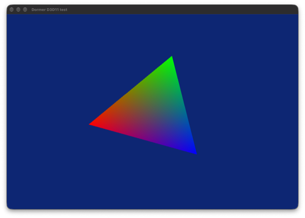
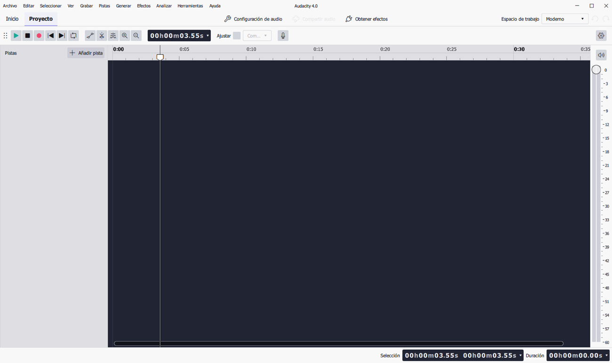
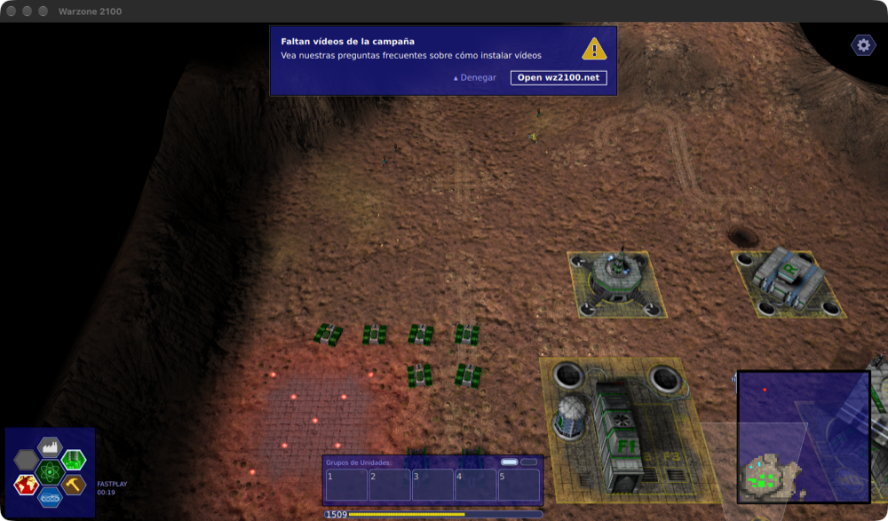

# Wine con DXMT: parche, receta y resultados

**Estado (2026-11-12):** con un `winemac.so` recompilado con el parche de esta carpeta, DXMT v0.80 **dibuja en ventanas** dentro del Wine 11.21 de Gcenx. Probado con un programa Direct3D 11 propio y con Audacity 4.0.2. Sigue siendo un experimento: **Dormer todavía no lo incluye** y la capacidad `dxmt` sigue en `false`.

| | |
|---|---|
|  |  |
| Programa de prueba ([tests/d3d11-triangle.cpp](tests/d3d11-triangle.cpp)) | Audacity 4.0.2: editor de proyecto |

## El problema, en tres capas

DXMT presenta a través de un `CAMetalLayer` que pide al controlador de Mac de Wine (`winemac.so`). Con el Wine de Gcenx fallaban tres cosas, una detrás de otra:

1. **Símbolos ocultos.** Wine compila `winemac.so` con visibilidad oculta, así que el `dlsym` de DXMT no encuentra nada (`your Wine has no exported symbols needed by DXMT`).
2. **Estructura distinta.** Exportar los símbolos no basta (fue el primer intento, commit `ec477d0`): DXMT lee `client_cocoa_view` en la posición que tiene en CrossOver, y en Wine 11.21 esa posición es otro campo. Leía un puntero basura. Además, en Wine actual una ventana no tiene vista cliente hasta que existe una *client surface*.
3. **La vista se oculta.** Cada vez que Wine vuelca la superficie GDI de la ventana (por ejemplo al redimensionar) oculta la vista cliente y espera que Vulkan/OpenGL la vuelva a mostrar en su siguiente `client_surface_present()`. DXMT no pasa por ahí: la ventana se quedaba en blanco o gris.

## El parche

[0001-winemac-add-macdrv_functions-for-metal-layers.patch](0001-winemac-add-macdrv_functions-for-metal-layers.patch) (contra `wine-11.21`, ~190 líneas en `window.c`, `surface.c` y `macdrv.h`). Añade a `winemac.so` la tabla `macdrv_functions` que DXMT busca primero, con la forma que espera, y por dentro:

- crea una *client surface* para la ventana cuando DXMT pide su vista (igual que win32u hace para Vulkan/OpenGL);
- mantiene su tamaño y posición desde `WindowPosChanged`;
- no la oculta en el volcado GDI mientras exista su vista Metal;
- la libera junto con la vista Metal o con la ventana.

No modifica DXMT: se usa su versión publicada sin cambios.

**Límites conocidos del parche:** máximo 64 ventanas con cadena de intercambio a la vez por proceso; mientras exista la cadena de intercambio, el contenido GDI de esa ventana queda tapado; cadenas de intercambio sobre ventanas hijas, modo Retina, pantalla completa y varios monitores **sin probar**.

## Receta para reconstruir `winemac.so`

Ejecutada a mano en una carpeta aparte, sin instalar nada en el sistema. No está automatizada.

1. Fuente oficial: `https://dl.winehq.org/wine/source/11.x/wine-11.21.tar.xz`.
2. Herramientas: GNU bison ≥ 3 (se compiló 3.8.2; el de macOS es 2.3) y `llvm-mingw` (20261104, ucrt, macos-universal; Wine 11 exige un compilador cruzado de Windows).
3. `patch -p1 < 0001-…patch`
4. En una carpeta de compilación aparte, con `llvm-mingw/bin` **al final** del `PATH` (si va delante, su `clang` tapa al de Apple):
   ```sh
   CC="/usr/bin/clang -arch x86_64" CXX="/usr/bin/clang++ -arch x86_64" \
     ../wine-11.21/configure --host=x86_64-apple-darwin --enable-win64 --disable-tests \
     --without-x --without-freetype   # y los demás --without-… que no hagan falta
   make -j8 dlls/winemac.drv/winemac.so
   ```
5. Reemplazar `lib/wine/x86_64-unix/winemac.so` en una **copia** del motor que ya tenga los archivos de DXMT (Dormer crea esas variantes como clon APFS).
6. Comprobar: `nm -gU winemac.so | grep macdrv_functions`.

**Sin verificar:** las sumas del tarball de Wine y de `llvm-mingw` contra sus fuentes oficiales. SHA-256 del `winemac.so` resultante en esta máquina: `e03fdeac075cb93ac201f5a28fc15ceaf167a6713808e431f6a91438b0225a72` (no se publica el binario; la compilación no es reproducible bit a bit todavía).

## Pruebas (MacBook Air M5, macOS 27.2.1, Rosetta 2, pantalla externa 1920×1080)

Programa propio [tests/d3d11-triangle.cpp](tests/d3d11-triangle.cpp) (compilado con `llvm-mingw`: `x86_64-w64-mingw32-clang++ -O1 -static -mwindows d3d11-triangle.cpp -o tri.exe -ld3d11 -ld3dcompiler_47 -ldxgi`):

- ✅ Dispositivo de nivel 11.0, cadena de intercambio, sombreadores compilados con `D3DCompile`, triángulo girando: 1775 fotogramas en 30 s (sincronizado a ~60 Hz).
- ✅ Mover la ventana y redimensionarla (`ResizeBuffers`) sigue dibujando.

Audacity 4.0.2 (Qt 6, `.msi`, con `vcrun2022`):

- ✅ Se dibujan la ventana principal, el asistente inicial, los diálogos «Bienvenido» y «Restaurar sesión», la página de proyectos y el editor de un proyecto nuevo. Responde a clics.
- ℹ️ DXMT registra `err: Not implemented` al arrancar: Qt pide primero una cadena de intercambio de DirectComposition (`CreateSwapChainForComposition`), que DXMT no implementa, y recurre a la cadena normal por ventana. No impide dibujar.
- ❓ **Sin probar:** grabar, reproducir, importar/exportar audio, efectos, uso prolongado. «Se dibuja y responde» no es «funciona todo».

Warzone 2100 4.7.0 (juego libre; zip portable del repositorio oficial, SHA-256 verificado; `--gfxbackend=directx`, es decir ANGLE sobre Direct3D 11):

- ✅ ANGLE obtiene un dispositivo Direct3D 11 de nivel 11.1 (`vs_5_0 ps_5_0`); se dibujan el menú y una partida rápida en 3D, y responde a clics.
- ❓ **Sin probar:** sonido, partidas largas, rendimiento medido, pantalla completa.



Ningún juego comercial probado todavía (Euro Truck Simulator 2, versión de prueba oficial, pendiente).

## Para Wine (upstream)

Esto es un parche de compatibilidad, no una propuesta lista para WineHQ: fija dentro de Wine una estructura heredada de CrossOver. Lo razonable es llevarles el **problema** y un diseño más limpio:

- una interfaz documentada para que una capa externa obtenga una *client surface* registrada en win32u (con sus avisos de cambio de tamaño y de destrucción) y su `CAMetalLayer` a partir de un `HWND`; hoy `use_window_client_surface()` es interno de win32u y por eso el parche tiene que sincronizar a mano;
- o que la capa llame a `client_surface_present()` en cada fotograma, como hacen Vulkan y OpenGL.

Envío: lista `wine-devel` o *merge request* en `gitlab.winehq.org`, con cuenta propia de quien envía y siguiendo su guía de contribución. **Dormer no puede enviarlo por ti.** También tiene sentido avisar al proyecto DXMT, que es quien decide qué interfaz consume.

## Siguiente

1. Probar más programas Direct3D 11 (y Direct3D 10) y juegos más exigentes; anotar cada resultado en [docs/COMPATIBILITY.md](../../docs/COMPATIBILITY.md).
2. Probar Retina, pantalla completa y ventanas hijas.
3. Integrarlo de serie en Dormer: compilar `winemac.so` en CI con esta receta y sumas verificadas, publicar el binario con su fuente y parche (LGPL), y activar la capacidad `dxmt` solo para ese motor.
